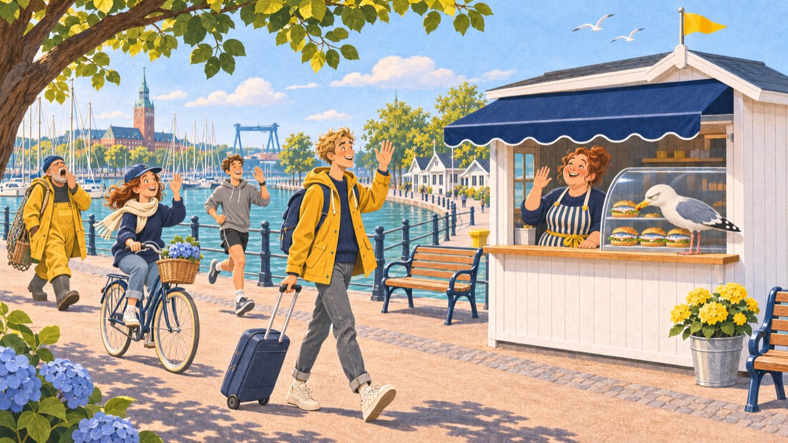
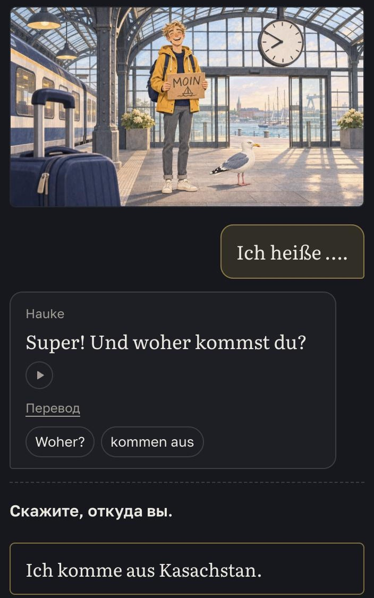
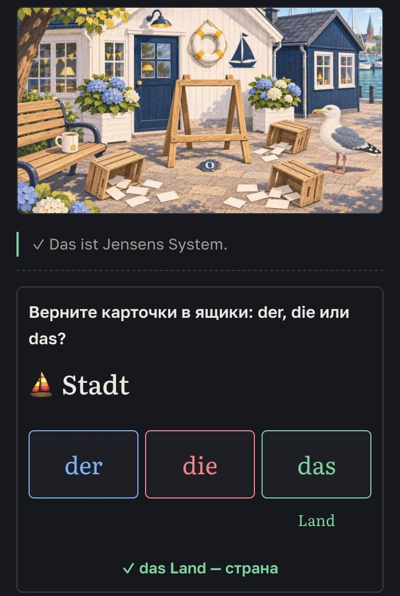
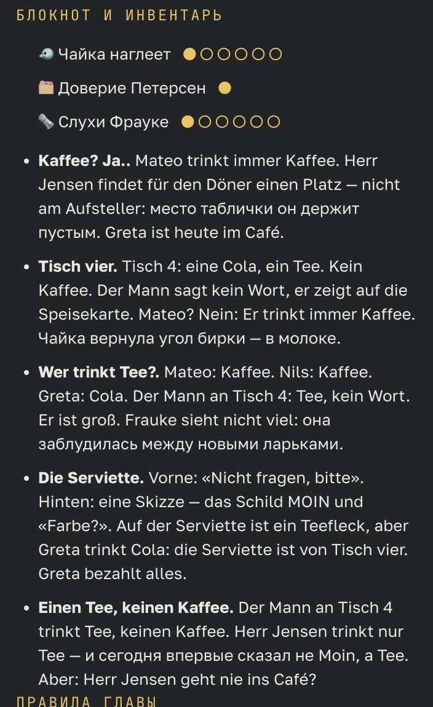

<h1 align="center">Stunning Deutsch</h1>

<p align="center">
  <b>German from zero to A1, told as a detective story.</b><br>
  A free browser course for Russian speakers that prepares for telc Deutsch A1 / Start Deutsch 1.
</p>

<p align="center">
  <a href="https://stunning-deutsch.deelstuff.com"><b>Open the course → stunning-deutsch.deelstuff.com</b></a>
</p>

<p align="center">
  
</p>

## The case

The old **MOIN** sign has gone missing from a sailing club in Kiel, and you know exactly one German word. To find the sign, you meet people, question witnesses, read notes and listen to announcements. Over 13 chapters the story moves from Russian to German: the first chapter is almost all Russian, and by the last one you read the clues without a translation.

The interface and explanations are in Russian. There is no sign-up: the course opens at once and keeps your progress in your browser.

<table>
  <tr>
    <td width="33%"></td>
    <td width="33%"></td>
    <td width="33%"></td>
  </tr>
  <tr>
    <td align="center">Answer the characters</td>
    <td align="center">Sort words by article</td>
    <td align="center">Collect clues in the notebook</td>
  </tr>
</table>

## How it teaches

A word stays in memory when you needed it for the case, heard it aloud and met it again in different situations. Every chapter is built on that.

- **A story instead of a textbook.** Each word is tied to a person, a place or a joke. The case moves on only when you understand a line and answer it.
- **German arrives step by step.** Words you already know come back into the narration in German. Any word shows its translation on tap.
- **The article sticks to the word.** *der*, *die* and *das* have their own colours throughout the game, and the Docks game sorts words until the article comes by itself.
- **You build the phrase yourself.** You turn the dials of a lock, put sentences together from tiles and type words. The check is exact and shows the word with the mistake.
- **A rule comes when you need it.** A short card with an example and a table opens right before the task that needs it.
- **Words return until they stay.** A round of three games runs before each chapter and at the start of a new day. A word you remember comes back less and less often: after one day, then two, four, eight and so on. A mistake brings it back sooner.
- **More than thirty kinds of tasks.** A clock, a till, a route on a map, a photofit, logic grids, a race with a gull. The same kind of task never comes twice in a row.
- **Listening from day one.** Every line is voiced. You hear announcements, messages and conversations first and answer from what you heard.
- **Writing and speaking.** You write short messages from a model and speak aloud first, then compare yourself with the model.
- **Mistakes don't punish.** A wrong answer gives an explanation and another try, and your progress stays.
- **Exam format.** From chapter 2, tasks carry the same German instructions as the exam. The last chapter walks through all four parts of Start Deutsch 1.

## What's inside

- **The Case of the Missing Moin.** 13 chapters of scenes with dialogue, mini-games and review rounds, with checks inside the story after chapters 4 and 8.
- **A1 reference.** All 66 grammar rules and 970 exam words that the story teaches, on one page, with search, audio and the chapter where each one appears.
- **Topic notes.** Twelve A1 topics with detailed explanations, cheat sheets, drills and word lists.
- **Checks and a mock exam.** Short checks after topics 4, 8 and 12, and a mock exam with all four parts of Start Deutsch 1 and the exam's timing: listening, reading, writing and speaking.

## Run it locally

You need Node.js 22.18+ and pnpm.

```sh
pnpm install
pnpm dev        # http://127.0.0.1:5180
```

| Command | What it does |
|---|---|
| `pnpm content` | Validates the content and builds `src/generated/` |
| `pnpm check` | Validates the content only |
| `pnpm test` | Runs the tests: game answers, review scheduling, saves, word coverage |
| `pnpm typecheck` | Checks the TypeScript types |
| `pnpm build` | Content, type check and a static build into `dist/` |

All recordings are already in the repository, so the build needs no GPU.

## How it's built

```
content/*.yaml  ──pnpm content──▶  src/generated/*.json  ──▶  React pages
                                   public/audio/<hash>.m4a
```

- **Content is YAML.** Lessons, exam tasks and the Start Deutsch 1 word list live in `content/`. `scripts/build-content.mjs` validates them and stops with a clear message on an unknown field, a noun without a plural, a broken link or a task that its own tiles cannot build.
- **The story is code.** Each chapter is a set of scenes in `src/story/scenes/`. The game logic (`logic.ts`, `scene.ts`, `review.ts`, `progress.ts`) has no React and is covered by `node --test`.
- **Every exam word is tracked.** `scripts/a1-index.mjs` counts where each word and grammar rule of the exam appears. A word counts as learned after four uses in three chapters, with at least one action and one listening. A ratchet test keeps learned words from slipping out, and `scripts/a1-returns.mjs` plans the review rounds so that words from earlier chapters keep coming back.
- **Recordings are tied to the text.** Each German phrase has a pre-generated recording whose file name is a hash of the text, the voice and the model settings. A changed phrase needs a new recording, and the build stops when one is missing. The process is in [scripts/tts/README.md](scripts/tts/README.md).
- **Saves are versioned.** Progress lives in `localStorage` and is stored per scene step, so editing one task resets only that answer, and older saves still open.
- **A static site.** Addresses look like `#/a1/moin`, so `dist/` works on any static host. GitHub Actions runs the checks, tests and type check on every push. The site is deployed to GitHub Pages by a manual workflow.

Design notes are in Russian: [A1-PLOT.md](A1-PLOT.md) covers the story and the scene format, [A1-PLAN.md](A1-PLAN.md) the course and word coverage, [CONTENT.md](CONTENT.md) the lesson format, and [AGENTS.md](AGENTS.md) the rules for working on the code.

## Credits

- **Voices:** [OmniVoice](https://huggingface.co/k2-fsa/OmniVoice) by k2-fsa (code Apache 2.0, model CC BY-NC). The project is non-commercial.
- **Illustrations:** generated with an AI image model from character reference sheets in `art/refs/`, each one checked by eye.
- **Exam format:** follows the Goethe-Institut description of Start Deutsch 1 (*Prüfungsziele und Testbeschreibung*); telc Deutsch A1 and Goethe-Zertifikat A1 are the same exam. The project is not affiliated with telc or the Goethe-Institut. All tasks and recordings are original.

## Feedback

I'm Andrei. I build this project to learn German myself, and I'd be glad of any comments and ideas: [write to me on Telegram](https://t.me/aiatsuk).
